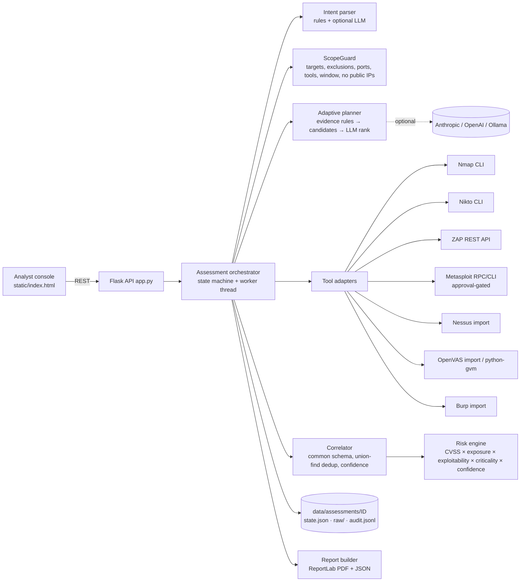

# VAPT-Agent — AI Agent for Automated, Human-Supervised Penetration Testing

A conversational, evidence-driven AI agent that runs an **authorized** assessment from a natural-language
request through to a client-ready PDF VAPT report:

```
Analyst request → Scope validation → Agent plan (with reasons) → Analyst approves → Scans (Nmap/Nikto/ZAP)
→ Imports (Nessus/OpenVAS/Burp) → Normalise + correlate → Confidence + risk → Human approval gate
→ Approved non-destructive validation (Metasploit check) → Analyst triage → Unified PDF + JSON report
```

The agent plans adaptively. It chooses each follow-up tool only after it has evidence such as an open HTTP port, a TLS service or an SMB service. It records why it chose each step. It never fabricates findings, CVEs or CVSS scores. Every action is written to a hash-chained audit trail.

---

## 1. Quick start (Docker — recommended on Windows, macOS and Linux)

**Prerequisites:** Docker Desktop (or Docker Engine + Compose v2.24+), ~6 GB free disk, 8 GB RAM.

```bash
# 1. unzip / clone and enter the project
cd vapt-agent

# 2. (optional) configure an LLM — the agent also works without one (rule engine only)
cp .env.example .env          # Windows PowerShell: copy .env.example .env
#    edit .env -> LLM_PROVIDER=anthropic + ANTHROPIC_API_KEY=...   (or openai / ollama)

# 3. start agent + ZAP + Juice Shop + DVWA on the isolated 172.28.10.0/24 lab network
docker compose up -d --build

#    add Metasploitable 2 (FTP/SMB/telnet network targets):
docker compose --profile full up -d --build

#    add msfrpcd for approved validation (also set MSF_RPC_HOST=msf in .env, then re-run):
docker compose --profile full --profile validation up -d --build

# 4. open the console
#    http://localhost:8080
```

The first build downloads ~3 GB of images. ZAP takes about 30–60 seconds to start. After that, the **zap** chip in the header turns green.
When you're done: `docker compose --profile full --profile validation down`.

### Lab addresses (pre-registered in `config/scope.lab.json`)

| Address | Name | Purpose |
|---|---|---|
| 172.28.10.10 | `juice-shop` | OWASP Juice Shop — modern web app + API (port 3000) |
| 172.28.10.11 | `dvwa` | DVWA — PHP web app (port 80) |
| 172.28.10.12 | `metasploitable` | Metasploitable 2 — legacy Linux network services (`full` profile) |
| 172.28.10.1/.5/.6/.7 | gateway / agent / ZAP / msfrpcd | **Excluded** — the agent never scans its own tooling |

---

## 2. Native setup (Linux / Kali — no agent container)

```bash
sudo apt install -y nmap nikto python3-venv         # Kali already has nmap + nikto (+ metasploit)
python3 -m venv .venv && source .venv/bin/activate
pip install -r requirements.txt msgpack pytest

# lab targets + ZAP in Docker (Linux hosts can reach the 172.28.10.0/24 bridge directly)
docker compose up -d zap juice-shop dvwa
docker compose --profile full up -d metasploitable
# ZAP's API must be reachable from the host: add  ports: ["127.0.0.1:8090:8090"]  to the zap service,
# or run ZAP natively: zap.sh -daemon -port 8090 -config api.key=vapt-lab-zap-key

cp .env.example .env            # set ZAP_URL=http://localhost:8090 and your LLM settings
python -m vapt_agent            # console on http://127.0.0.1:8080
```

On **Windows or macOS without the agent container**, the host can't reach Docker bridge IPs. Publish the lab apps on localhost instead:
`docker run -d -p 127.0.0.1:3000:3000 bkimminich/juice-shop` and `docker run -d -p 127.0.0.1:8081:80 vulnerables/web-dvwa`.
Then set `VAPT_SCOPE_FILE=config/scope.local.json`, install nmap/nikto for your OS, and run ZAP locally on port 8090.

### No scanners at all? Run the offline demo

```bash
pip install -r requirements.txt
python scripts/offline_demo.py      # drives the full pipeline with the synthetic fixtures; writes a PDF
python -m pytest -q tests           # 14 tests: scope, parsers, correlation, risk, safety gates, audit chain
```

The offline demo uses **synthetic parser fixtures** (`tests/fixtures/`, labelled in each file). Its PDF is watermarked
**SYNTHETIC TEST DATA**. Live tools that are missing show up honestly as `unavailable` jobs.

---

## 3. Using the console (maps 1:1 to the judges' checklist)

1. **Request + scope validation.** Type, for example, *"Run a full end-to-end network and web assessment of 172.28.10.0/24"*.
   Try *"Scan 8.8.8.8"* to see the scope guard reject it. You can also test any target in the **Scope** tab.
2. **Plan with reasoning.** The **Plan & Approvals** tab lists each proposed action with its rationale, plus the
   *anticipated adaptive steps*. Click **Approve plan**.
3. **Multi-tool execution.** The **Jobs** tab shows status, the exact command or API calls that ran, retries, errors and links to the raw output.
   Follow-up non-intrusive scans are queued automatically from evidence (see the **Decisions** tab for the reasoning).
   In the **Imports** tab, upload Nessus `.nessus`, OpenVAS XML or Burp XML exports.
4. **Normalisation and correlation.** The **Findings** tab shows raw→correlated counts, the tools behind each finding, confidence
   factors (corroboration, banner-only inference, "port not observed open by Nmap"), severity disagreements and per-evidence raw links.
   Use **Mark false positive** (a reason is required) to triage.
5. **Risk and the approval gate.** Findings are sorted by contextual risk, with the full formula shown. Validation and intrusive actions
   appear under **⚠ Human approval required**. **Approve** or **Reject** them with a reason. Every decision is recorded.
6. **Report.** In the **Report** tab, click **Generate report** and download the PDF/JSON. Each finding lists its evidence as
   `tool | job | timestamp | raw file | sha256`, and the raw file can be opened from the Jobs or Findings tab.
7. **Safe failure and honesty.** Stop ZAP (`docker stop vapt-zap`) and re-run: the job becomes `unavailable`, the agent records the
   coverage gap, and it continues with Nikto. The **Integrations** tab shows each tool's declared status and its runtime availability.

You can chat with the agent at any time: "why nikto?", "status", a finding ID such as `F-3D1BD0`, or free-form questions when an LLM is set up.

---

## 4. Architecture



| Concern | Implementation |
|---|---|
| **AI model(s)** | Pluggable: Anthropic Claude, any OpenAI-compatible API, or a local Ollama model (e.g. `llama3.1:8b`). Optional — a deterministic rule engine always produces the plan. The LLM may only **rank or drop rule-generated candidates**, add reasoning, interpret the request, answer questions, and write the clearly labelled executive summary. Any CVE it mentions that is not in the evidence is stripped (`llm.ground_text`). |
| **Orchestration** | `orchestrator.py`: per-assessment worker thread, one job at a time (respects rate limits), timeouts, one retry for transient errors, no retry for `unavailable` or `timeout`, a scope re-check just before each job, an action budget, and de-duplication by action key (tool + target + params hash). |
| **Tool adapters** | `adapters/*.py` share one contract (`run()` for live, `parse()` for import), emitting `RawFinding` + `Evidence` + `Host`. |
| **Data flow** | raw output → saved to `raw/` with SHA-256 → parsed → scope-filtered → `raw_findings` → correlated `findings` → prioritised → report. |
| **State / memory** | `state.json` (hosts, services, actions, jobs, findings, approvals, overrides, validations, decisions) is persisted after every change and reloaded on restart. Planning reads the accumulated state, so later steps depend on earlier results. |
| **Security boundaries** | ScopeGuard on every request, plan, job, import and validation; public IPs refused by default; exclusions passed to nmap `--exclude`; Nikto DoS checks disabled; ZAP active scan and all Metasploit actions need per-action approval; Metasploit is limited to an allow-list, `check` for exploit modules, never a payload; console bound to 127.0.0.1; optional API token; hash-chained audit log. |

More detail is in [`docs/ARCHITECTURE.md`](docs/ARCHITECTURE.md).

### Common finding schema (excerpt)
`id, identity, title, category, severity, cvss_score/vector/source (tool-supplied only), cves, cwes, owasp, attack,
affected[{asset, hostname, port, url, service}], evidence[{source_tool, asset, port, url, observed_at, raw_ref, raw_sha256,
job_id, excerpt, tool_title, tool_severity, tool_confidence, tool_ref_id, mode}], source_tools, confidence,
confidence_factors, status (suspected|confirmed|likely_false_positive|false_positive), validation[], risk_score,
risk_breakdown, priority, solution, references, notes`

### Correlation rules
Raw findings on the **same asset** are merged when they share a CVE, map to the same canonical category
(e.g. ZAP "Missing Anti-clickjacking Header" = Nikto "X-Frame-Options header is not present"), or have near-identical titles.
Findings on different assets are **never** merged, and every piece of evidence is kept. When tools disagree on severity, the disagreement is
noted on the finding; a tool-supplied CVSS takes precedence.

### Confidence and risk
Confidence starts at the strongest **tool-reported** confidence (ZAP confidence, Burp certainty, OpenVAS QoD), then adjusts:
**+0.15/+0.2** when two or three tools corroborate, **−0.15** when the finding rests only on a version banner, **−0.25** when Nmap did not see the port open, and
**−0.2** when an approved check did not confirm it. Confirmed validation raises confidence to ≥0.97. Below 0.2 confidence, a finding is marked `likely_false_positive`.

`risk = base(CVSS from tool, else severity midpoint) × exposure × exploitability × asset criticality × (0.5 + 0.5·confidence)`, capped at 10.
P1 ≥ 8.5, P2 ≥ 6.5, P3 ≥ 4.0, P4 > 0.

---

## 5. Integration status matrix (truthful)

| Tool | Status | How | Limitations |
|---|---|---|---|
| **Nmap** | **Live** + Import | CLI, XML parsing, safe NSE scripts only | TCP only; no OS detection by default |
| **Nikto** | **Live** + Import | CLI, XML; `-Tuning x6` (no DoS) | Nikto has no severity ratings: the agent classifies severity and labels it as its own |
| **OWASP ZAP** | **Live** + Import | REST API (daemon): spider + passive scan; active scan only after explicit approval | No authenticated contexts |
| **OpenVAS/Greenbone** | **Import**; live mode experimental | XML report import; `python-gvm` live mode when `GVM_SOCKET` is set | Live mode untested outside a GVM deployment |
| **Nessus** | **Import-only** | `.nessus` v2 | Nessus Essentials/Pro don't allow API scan launch — no live scans are claimed |
| **Burp Suite** | **Import-only**; Pro REST API planned | "Report issues" XML export | Exporting scanner issues needs Burp Pro (or a trial); Community has no scanner/API |
| **Metasploit** | **Live, approval-gated** | msfrpcd (msgpack) or `msfconsole`; curated allow-list; `check` / auxiliary scanners only | Never runs payloads; no autonomous exploitation |

**Unsupported scenarios:** authenticated scanning, UDP, IPv6 sweeps, cloud/API-only targets outside the lab,
retesting/diffing between assessments (planned), multi-user roles (single analyst per console).

### Getting import files
* **Nessus Essentials** (free registration, up to 16 IPs): scan the lab → *Export → Nessus*.
* **OpenVAS**: Greenbone Community Containers → *Reports → Download → XML*.
* **Burp Pro**: *Target → Site map → right-click → Issues → Report issues → XML* (base64 requests/responses on).
* **ZAP / Nikto / Nmap** recorded runs can also be imported (`-oX`, `-Format xml`, ZAP *Traditional JSON/XML report*).

---

## 6. LLM configuration

| Provider | `.env` |
|---|---|
| none (default) | `LLM_PROVIDER=none` — rule-based planning, templated text |
| Anthropic | `LLM_PROVIDER=anthropic`, `ANTHROPIC_API_KEY=…`, `ANTHROPIC_MODEL=claude-sonnet-4-5` |
| OpenAI-compatible | `LLM_PROVIDER=openai`, `OPENAI_API_KEY=…`, `OPENAI_MODEL=…`, `OPENAI_BASE_URL=…` |
| Ollama (local, free) | `LLM_PROVIDER=ollama`, `OLLAMA_URL=http://host.docker.internal:11434` (Docker) or `http://localhost:11434`, `OLLAMA_MODEL=llama3.1:8b` |

If an LLM call fails, the agent logs `llm-error` in the decision trace and continues with the rule plan.

---

## 7. Project structure

```
vapt-agent/
├── vapt_agent/
│   ├── app.py            Flask REST API + serves the console
│   ├── orchestrator.py   assessment state machine, worker, approvals, imports, Q&A
│   ├── planner.py        evidence-driven adaptive planning (+ LLM ranking)
│   ├── intent.py         natural-language request → structured intent
│   ├── scope.py          ScopeGuard
│   ├── correlate.py      normalisation, de-duplication, confidence calibration
│   ├── risk.py           contextual risk prioritisation
│   ├── report.py         PDF (ReportLab) + JSON export
│   ├── knowledge.py      categories, CWE→OWASP, ATT&CK, remediation, Metasploit allow-list
│   ├── audit.py          hash-chained audit log
│   ├── llm.py            Anthropic / OpenAI / Ollama client + grounding filter
│   ├── models.py         common data model
│   ├── adapters/         nmap, nikto, zap, metasploit, imports (nessus, openvas, burp)
│   └── static/index.html analyst console (no build step)
├── config/scope.lab.json     registered lab scope (edit for your organiser's lab)
├── config/scope.local.json   localhost variant
├── tests/                    unit tests + SYNTHETIC parser fixtures
├── scripts/offline_demo.py   scanner-free end-to-end demo
├── docs/                     architecture, demo script
├── Dockerfile, docker-compose.yml, requirements.txt, .env.example
```

---

## 8. Adapting to the organiser's lab
Edit `config/scope.lab.json`: set `targets` (IPs, CIDRs or hostnames with `criticality`/`exposure`), `exclusions`, `allowed_ports`,
`allowed_tools`, `max_rate_pps`, the engagement `window` and your `authorization_ref`. Then click **Reload scope file** in the Scope tab.
Keep `allow_non_private: false` unless the organiser explicitly authorises routable addresses.

## 9. Troubleshooting
| Symptom | Fix |
|---|---|
| `zap` chip red | Wait for ZAP to start (`docker logs vapt-zap`); check that `ZAP_API_KEY` matches in both services |
| nmap job `failed: … Operation not permitted` | Natively, run as root or let the agent fall back to `-sT` (it does this automatically when not root) |
| metasploit `unavailable` | Start the `validation` profile and set `MSF_RPC_HOST=msf` in `.env`, or install `msfconsole` natively |
| Juice Shop/DVWA not answering | `docker compose ps`; DVWA needs *Setup → Create/Reset Database* once before you can log in |
| Port 8080 busy | `VAPT_PORT=8090 python -m vapt_agent`, or change the compose port mapping |

## 10. Licensing assumptions
* Project code: MIT (see `LICENSE`).
* Nmap (NPSL), Nikto (GPL-2.0), OWASP ZAP (Apache-2.0), Metasploit Framework (BSD-3), OpenVAS/Greenbone Community (AGPL/GPL) are
  invoked as separate programs and not redistributed in this repository. The Docker image installs nmap/nikto at build time.
* **Nessus** and **Burp Suite Professional** are commercial. The agent only parses exports that you produce under your own licence;
  it doesn't bundle, emulate or bypass them.
* Lab images (Juice Shop MIT, DVWA GPL-3.0, Metasploitable 2) are intentionally vulnerable. Run them only on the isolated Docker network.

## 11. Safety and ethics
For authorized lab use only. Don't point the agent at third-party or public systems. The scope guard rejects them by default.
Raw scan data stays in `data/`; treat it as sensitive and delete it after the engagement.
