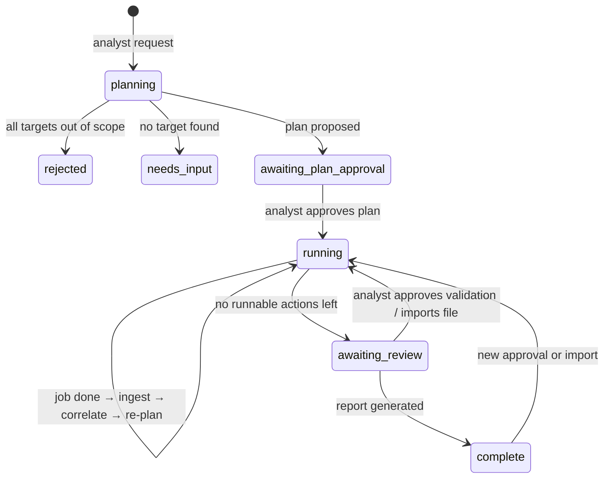
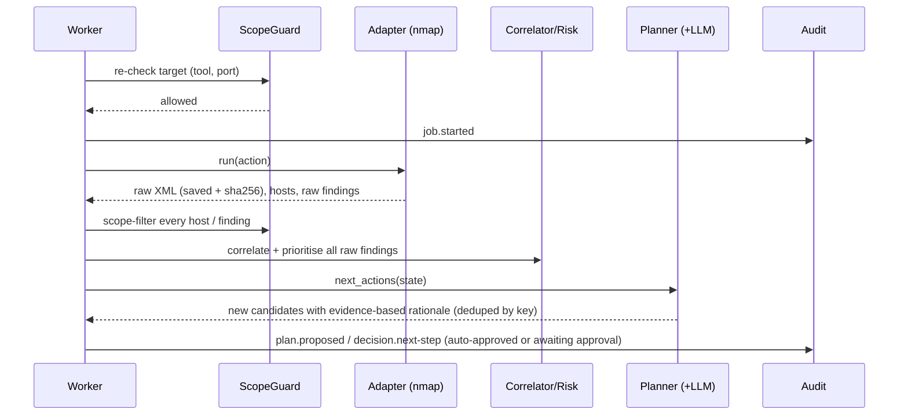

# Architecture overview

## 1. Components

| Layer | Module | Responsibility |
|---|---|---|
| Presentation | `static/index.html` | Chat, plan/approval queue, jobs, assets, findings with evidence, decision trace, audit, imports, integration matrix, scope tester, report download |
| API | `app.py` | REST endpoints; binds to 127.0.0.1; optional `X-API-Token` |
| Orchestration | `orchestrator.py` | Assessment lifecycle, worker thread, approvals, imports, re-correlation, re-planning, Q&A |
| Reasoning | `intent.py`, `planner.py`, `llm.py` | Understanding the request, adaptive candidate generation, optional LLM ranking and narrative |
| Safety | `scope.py`, `audit.py`, adapter guards | Scope enforcement, hash-chained audit, approval checks inside the adapters |
| Integration | `adapters/` | Nmap, Nikto, ZAP (live); Nessus, OpenVAS, Burp (import); Metasploit (approval-gated live) |
| Analysis | `correlate.py`, `risk.py`, `knowledge.py` | Common schema, de-duplication, confidence calibration, OWASP/CWE/ATT&CK mapping, risk |
| Output | `report.py` | PDF sections 1–6 + appendices; JSON export |

## 2. Assessment state machine



## 3. Action life-cycle and approval policy

```
proposed ──(analyst approve)──► approved ──► running ──► done | failed
    │                               ▲
    └──(analyst reject)──► rejected │
                                    └── policy:auto  (ONLY non-intrusive follow-ups, ONLY after the plan was approved)
```

| Action type | Approval needed |
|---|---|
| Initial recon (nmap) | Plan approval |
| Follow-up non-intrusive scans (nmap safe NSE, Nikto, ZAP spider/passive) | Covered by plan approval (`VAPT_AUTO_APPROVE_FOLLOWUPS=true`); set to `false` to require a click for each |
| ZAP active scan (intrusive) | Separate per-action approval |
| Metasploit validation | Separate per-action approval. The adapter itself refuses to run without `decided_by=analyst:*`, outside the allow-list, or out of scope |

## 4. Sequence: one adaptive step



## 5. Adaptive planning rules (rule engine)

| Evidence observed | Next action |
|---|---|
| CIDR target | `nmap -sn` discovery → per-host service scan |
| Host target | `nmap -sV` top-N ports (N based on intensity) |
| URL target | `nmap -sV` on its port + adjacent common ports |
| HTTP service (focus includes web) | Nikto + ZAP spider/passive; http-methods NSE |
| TLS service | ssl-enum-ciphers, ssl-cert NSE |
| FTP service | ftp-anon NSE |
| SMB service | smb-security-mode, smb2-security-mode, smb-vuln-ms17-010 NSE |
| Intensity `thorough` and intrusive allowed | Propose a ZAP active scan (needs approval) |
| Suspected finding with a mapped non-destructive Metasploit module | Propose validation (needs approval) |
| Tool unavailable or failed | Record the coverage gap and the fallback; don't retry `unavailable` |

The LLM (if configured) receives the evidence summary and candidates. It can only keep or drop candidate IDs. It can't add tools, targets or parameters,
and it can't drop a validation option the analyst should see.

## 6. Evidence vs inference
* **Observed evidence**: verbatim excerpts from raw tool output, with job ID, timestamp, raw path and SHA-256.
* **Agent classification**: severity for tools that don't rate it (Nikto, Nmap scripts), labelled `unrated (agent-classified …)`.
* **AI inference**: LLM text, shown on a purple background in the PDF and prefixed `[AI inference…]` in chat, and filtered so it can't cite a CVE absent from the evidence.

## 7. Persistence layout
```
data/assessments/ASM-xxxx/
  state.json      full assessment state (reloaded on restart; jobs that were running are marked failed: interrupted)
  audit.jsonl     append-only, hash-chained events
  raw/            JOB-xxxx_<tool output>  (immutable; referenced by sha256)
  report.pdf / report.json
```
